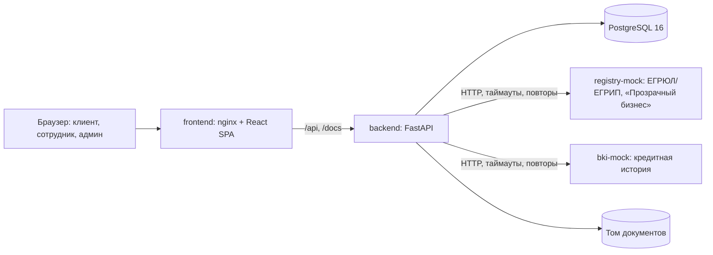

# CreditPath

Прототип цифрового кредитного конвейера для малого и микробизнеса: кейс «Умный кредитный кабинет предпринимателя».

Один веб-продукт объединяет путь клиента и обработку в банке:

- **клиент** выбирает продукт, проверяет компанию по ИНН, подаёт заявку и видит её статус в реальном времени;
- **автоматический конвейер** проверяет данные, обогащает их из реестра и кредитной истории, считает скоринг и готовит черновик решения;
- **сотрудник банка** принимает финальное решение;
- **администратор** управляет пользователями, продуктами и параметрами скоринга и проверяет неизменяемый журнал аудита.

> Все компании, ИНН, финансовые показатели, реестр и кредитная история синтетические. Подписание договора и зачисление средств имитируются и помечены в интерфейсе. Прототип не является кредитной организацией.

## Соответствие требованиям к сдаче

| Требование ТЗ | Где в репозитории |
|---|---|
| Код в GitHub с историей коммитов; идентификатор версии | `https://github.com/MeyFun/CreditPath`, ветка `main`. Версия для проверки — тег **`v1.0.1`** (исправление версии 1.0: удаление продуктов в справочниках). Исходный тег `v1.0-submission` сохранён без изменений. Репозиторий публичный |
| Cloud-native, запуск в Docker одной командой | [`docker-compose.yml`](docker-compose.yml), `Dockerfile` в `backend/`, `frontend/`, `mocks/*`; раздел [«Запуск»](#запуск) |
| Фиксация версий языка и библиотек | `.python-version` (3.12.10); `backend/requirements.lock`, `mocks/*/requirements.lock` (все транзитивные версии); `frontend/package-lock.json`; образы с точными тегами |
| README: назначение, архитектура, окружение, запуск, конфигурация, компоненты, сценарий проверки | этот файл |
| Синтетические данные и тестовые учётные записи | [учётки](#тестовые-учётные-записи), [ИНН и исходы](#синтетические-компании), `mocks/*/data.json`, генератор `scripts/generate_test_data.py` |
| THIRD_PARTY_NOTICES: компоненты, модели, датасеты, сервисы, смоделированные интеграции | [THIRD_PARTY_NOTICES.md](THIRD_PARTY_NOTICES.md) |
| Архитектурная схема | [docs/architecture.md](docs/architecture.md) |
| Описание API | [docs/api.md](docs/api.md) |
| OpenAPI / Swagger | http://localhost:8080/docs (Swagger UI без внешних CDN), [docs/openapi.json](docs/openapi.json) — тест сверяет файл с кодом |
| Коллекция запросов | [Postman: коллекция](docs/postman/CreditPath.postman_collection.json) и [окружение](docs/postman/CreditPath.postman_environment.json) |
| Диаграмма состояний заявки | [docs/state-diagram.md](docs/state-diagram.md) |
| Модель данных | [docs/data-model.md](docs/data-model.md) |
| Тестовые сценарии | [docs/test-scenarios.md](docs/test-scenarios.md), автотесты `backend/tests/`, e2e `scripts/e2e.py` |
| Без платных API, только синтетика, всё внутри продукта, только веб | реестр и БКИ — локальные моки; уведомления только во внутреннем центре; нет почты, SMS, мессенджеров и мобильного приложения |

Дополнительно: решения и их причины — [docs/DECISIONS.md](docs/DECISIONS.md), исследование и границы MVP — [docs/research.md](docs/research.md), развитие — [docs/ROADMAP.md](docs/ROADMAP.md), карта макетов — [docs/design-map.md](docs/design-map.md).

## Сквозной сценарий

```text
Гость      → каталог продуктов, калькулятор платежа, FAQ
Клиент     → потребность → продукт → проверка ИНН → черновик → полномочия и согласия → отправка
Система    → VALIDATION → ENRICHMENT (реестр + БКИ) → SCORING → DECISION_DRAFT → IN_REVIEW
Сотрудник  → одобрить / другие условия / запросить данные / отказать
Клиент     → оферта → демо-подписание → демо-зачисление
Админ      → пользователи и роли, продукты и цели, параметры скоринга, все заявки, проверка аудита
```

Скоринг не равен решению. Конвейер даёт оценку 0–100 и черновик решения с одним из четырёх исходов: одобрить, другие условия, запросить данные, отказать. Финальное решение всегда принимает сотрудник. Если сотрудник одобряет вопреки системе, это отдельно фиксируется как риск-исключение.

## Архитектура



| Компонент | Технологии | Ответственность |
|---|---|---|
| `frontend` | React 18, TypeScript, Vite, React Router, TanStack Query, nginx 1.27 | SPA для трёх ролей, прокси `/api` и `/docs`, CSP и security-заголовки |
| `backend` | Python 3.12, FastAPI, SQLAlchemy 2, Alembic, Pydantic v2 | Авторизация и RBAC, конечный автомат заявки, конвейер проверок, скоринг, кредитная логика, назначение, уведомления, аудит |
| `db` | PostgreSQL 16 | Все данные; триггер запрещает UPDATE/DELETE журнала аудита |
| `registry-mock` | FastAPI, статический JSON | Синтетический реестр компаний |
| `bki-mock` | FastAPI, статический JSON | Синтетическая кредитная история |

Подробно: слои backend, жизненный цикл запроса, модель безопасности, надёжность и масштабирование — в [docs/architecture.md](docs/architecture.md).

## Требования к окружению

- Docker Engine 24+ и Docker Compose v2.
- Около 2 ГБ свободной памяти.
- Свободные порты `8080`, `8000` и `55432`. Порты `8000` и `55432` слушают только `127.0.0.1`.
- Для запуска тестов без Docker: Python 3.12; для сборки фронтенда без Docker: Node.js 22.

## Запуск

```bash
docker compose up --build
```

Команда работает на чистом клоне без дополнительной настройки: у всех переменных есть демонстрационные значения по умолчанию. Миграции и демо-данные применяются автоматически при старте backend. Свои настройки можно задать в `.env`:

```bash
cp .env.example .env
```

| Что | Адрес |
|---|---|
| Веб-приложение | http://localhost:8080 |
| Swagger UI | http://localhost:8080/docs |
| OpenAPI JSON | http://localhost:8080/openapi.json |
| API напрямую | http://localhost:8000/api |
| Health / readiness backend | http://localhost:8000/health, http://localhost:8000/ready |
| PostgreSQL (только localhost) | `127.0.0.1:55432`, база/пользователь `creditpath`, пароль `creditpath_demo` |

Остановка: `docker compose down`. Данные лежат в именованных томах `postgres_data` и `uploads_data` и переживают перезапуск.

**Внимание:** `docker compose down -v` удаляет тома вместе со всеми заявками, документами и аудитом.

Посмотреть базу: `docker compose exec db psql -U creditpath -d creditpath`.

## Конфигурация и переменные окружения

Все настройки передаются через окружение (`.env` или переменные оболочки).

| Переменная | Назначение | По умолчанию |
|---|---|---|
| `FRONTEND_PORT` | Внешний порт nginx | `8080` |
| `BACKEND_PORT` | Порт API на `127.0.0.1` | `8000` |
| `POSTGRES_HOST_PORT` | Порт PostgreSQL на `127.0.0.1` | `55432` |
| `POSTGRES_DB` / `POSTGRES_USER` / `POSTGRES_PASSWORD` | База данных | `creditpath` / `creditpath` / `creditpath_demo` |
| `DATABASE_URL` | Строка подключения SQLAlchemy | собирается из `POSTGRES_*` |
| `JWT_SECRET` | Секрет подписи токенов | пусто: backend генерирует случайный секрет при старте (токены сбрасываются при перезапуске). Для постоянного стенда задайте свой |
| `ACCESS_TOKEN_MINUTES` | Срок жизни токена | `60` |
| `LOGIN_RATE_LIMIT` / `LOGIN_RATE_WINDOW_SECONDS` | Попытки входа с одного IP на логин и окно | `5` / `300` |
| `LOGIN_USER_RATE_LIMIT` | Мягкий лимит попыток на логин со всех IP | `20` |
| `FORWARDED_ALLOW_IPS` | Прокси, которым backend доверяет `X-Forwarded-For` | частные сети Docker |
| `CORS_ORIGINS` | Разрешённые origins через запятую | `http://localhost:8080,http://127.0.0.1:8080` |
| `DEMO_PASSWORD` | Пароль демо-учёток | `DemoPass123!` |
| `SEED_DEMO` | Создавать демо-учётки | `true` |
| `REGISTRY_URL` / `BKI_URL` | Адреса моков | `http://registry-mock:8000` / `http://bki-mock:8000` |
| `EXTERNAL_TIMEOUT_SECONDS` / `EXTERNAL_RETRIES` | Таймаут и число повторов внешних вызовов | `4` / `2` |
| `UPLOAD_DIR` / `MAX_UPLOAD_MB` | Каталог документов и лимит размера файла | `/data/uploads` / `10` |
| `RESUME_PIPELINES` | Возобновлять незавершённые проверки при старте | `true` |
| `LOG_LEVEL` | Уровень логирования (JSON-логи с request id) | `INFO` |

Параметры скоринга хранятся версиями в базе. Стартовая версия — `backend/app/scoring_config.yaml`. Администратор создаёт новые версии в интерфейсе; каждая проходит пробный расчёт перед сохранением.

## Тестовые учётные записи

Пароль всех учёток: **`DemoPass123!`**. На странице входа есть кнопка с тестовыми данными.

| Логин | Роль | Что показывает |
|---|---|---|
| `client1` | Клиент | ООО «Северный Ветер», ИНН из профиля подтверждает полномочия |
| `client2` | Клиент | ООО «Торговый Дом Волга» |
| `client3` | Клиент, связанное лицо | ИП Кузнецова, родственница `employee3`: её заявки не назначаются `employee3` |
| `employee1`, `employee2`, `employee3` | Сотрудник банка | Очередь назначенных заявок и решения |
| `admin` | Администратор | Пользователи, роли, продукты, скоринг, все заявки, аудит; без права кредитного решения |

## Синтетические компании

ИНН начинаются с `99` и имеют корректную контрольную сумму ФНС (10 цифр — юрлицо, 12 — ИП).

| ИНН | Компания | Ситуация | Ожидаемый исход |
|---|---|---|---|
| `9900000017` | ООО «Северный Ветер» | здоровая компания | Одобрено |
| `9900000024` | ООО «Гранит-Снаб» | активная просрочка | Отказ (стоп-фактор) |
| `9900000031` | ООО «Торговый Дом Волга» | 8 млн при выручке 10 млн | Одобрено на других условиях (≈ 4 млн) |
| `9900000049` | ООО «Тихий Двор» | нет финансовых показателей | Нужны данные, после ответа — одобрено |
| `9900000056` | ООО «Архив-Строй» | ликвидирована | Отказ (стоп-фактор) |
| `990000001246` | ИП Кузнецова М. С. | ИП, кредит на оборудование с залогом | Одобрено |
| `9900000063` | ООО «Старт Логистик» | молодая компания | Одобрено на других условиях |
| `9900000070` | ООО «Удача Плюс» | рисковый ОКВЭД, убыток | Отказ |
| `9900000088` | — | валидный ИНН, нет в реестре | Ошибка на шаге проверки ИНН |

## Пошаговый сценарий проверки (5–7 минут)

1. **Гость.** Откройте http://localhost:8080. Посмотрите продукты, калькулятор и FAQ. Нажмите «Войти»: регистрации нет.
2. **Заявка клиента.** Войдите как `client1`. Нажмите «Новая заявка». На шаге «Потребность» выберите «Пополнение оборотных средств», продукт подберётся сам. ИНН `9900000017` подставлен из профиля, полномочия подтверждены автоматически. Укажите 3 000 000 ₽ на 24 мес., при желании приложите PDF. На последнем шаге выберите должность, подтвердите полномочия и согласия на запрос в БКИ и обработку ПДн, отправьте.
3. **Конвейер.** Статус меняется сам, без перезагрузки: проверка данных → реестр и БКИ → скоринг → передача сотруднику.
4. **Сотрудник.** Войдите как `employee1` (если заявка ушла другому — `employee2` или `employee3`). В «Очереди заявок» откройте карточку: реестр, БКИ, факторы скоринга, черновик решения. Нажмите «Одобрить».
5. **Оферта.** Снова `client1` → «Мои заявки» → «Открыть решение». Примите оферту, нажмите «Подписать договор», затем «Получить средства». Статус «Средства перечислены».
6. **Другие условия.** Заявка с ИНН `9900000031` на 8 000 000 ₽: система предложит ≈ 4 000 000 ₽. Сотрудник выбирает «Другие условия» и может изменить сумму, срок или продукт.
7. **Отказ и «свежий взгляд».** Заявка с ИНН `9900000024`: стоп-фактор «активная просрочка». Сотрудник отказывает с причиной. Клиент нажимает «Подать заново». Повторную заявку получает другой сотрудник и видит историю прошлых решений.
8. **Нужны данные.** Заявка с ИНН `9900000049` на 1 500 000 ₽ получает статус «Требуется уточнение». Укажите выручку `6000000` и прибыль `800000`: проверки продолжатся автоматически.
9. **Связанное лицо.** `client3` подаёт заявку на «Кредит на оборудование» (ИНН `990000001246`, с залогом). Её получит `employee1` или `employee2`, но не `employee3`; в карточке отметка «Связанное лицо».
10. **Администратор.** Войдите как `admin`: смена роли с подтверждением, все заявки и ручное назначение, журнал аудита и кнопка «Проверить целостность», справочники: создайте продукт с целью — он сразу появится у клиента в каталоге и мастере заявки; продукт без заявок можно удалить, с заявками — только скрыть; новая версия параметров скоринга.
11. **Права.** Клиент не видит чужие заявки; сотрудник не видит неназначенные заявки и заявки связанных лиц; администратор не принимает кредитных решений; у сотрудника и администратора нет клиентского кабинета.

Тот же сценарий через API — в [docs/api.md](docs/api.md#сквозной-сценарий-через-api) и Postman-коллекции. Полный список проверок, включая негативные, — в [docs/test-scenarios.md](docs/test-scenarios.md).

## Автоматические проверки заявки

1. **VALIDATION:** полнота полей, ИНН (длина и контрольная сумма), лимиты продукта, цель, обеспечение.
2. **ENRICHMENT:** запросы к `registry-mock` и `bki-mock` с таймаутом и повторами; сырые ответы сохраняются снимком. Если источник недоступен, заявка переходит в «Требуется уточнение» с понятным сообщением и не теряется.
3. **SCORING:** 0–100, база 50, прозрачные факторы: возраст бизнеса, сумма к выручке, прибыль, просрочки, долговая нагрузка, ОКВЭД, обеспечение.
4. **DECISION_DRAFT:** отдельный слой кредитной логики. Стоп-факторы: недействующая компания, активная просрочка, требования продукта. Нет финансовых данных → запрос данных. Балл ≥ 70 → одобрить; 40–69 → другие условия; < 40 → отказ.
5. **IN_REVIEW:** назначение по минимальной нагрузке с правилами «свежего взгляда» и связанных лиц. Решение принимает человек.

Если backend перезапустился во время проверок, при старте он продолжает обработку незавершённых заявок с сохранённого этапа.

## Безопасность и надёжность

- RBAC и проверка прав на конкретную заявку на каждой ручке; интерфейс не является границей безопасности. Клиентский кабинет доступен только роли «Клиент».
- Пароли — Argon2id. JWT с ограниченным сроком. Если секрет не задан, он генерируется случайно, а не берётся из кода. Лимит попыток входа по IP+логину и мягкий лимит по логину; время ответа не выдаёт, существует ли логин.
- Клиент не получает внутренние данные банка: балл и факторы скоринга, черновик решения, назначения, риск-исключения.
- При отправке фиксируются должность заявителя, подтверждение полномочий и согласия на БКИ и ПДн. Полномочия проверяются сервером: компания из профиля или руководитель/учредитель по реестру — автоматически, иначе нужна доверенность, которую проверяет сотрудник.
- Изменения заявки блокируют строку (`SELECT … FOR UPDATE`); отправка защищена `Idempotency-Key`.
- Загрузка файлов: проверка типа, расширения, сигнатуры и размера; приватный том; скачивание только через авторизованные ручки.
- CSP и security-заголовки в nginx и FastAPI; CORS из конфигурации; API и БД опубликованы только на `127.0.0.1`.
- Аудит append-only: триггер PostgreSQL запрещает UPDATE/DELETE, SHA-256-цепочка проверяется из интерфейса.
- Healthchecks, `restart: unless-stopped`, старт только после готовности зависимостей; backend и моки работают от непривилегированного пользователя.
- Зависимости без известных уязвимостей на момент сдачи: `pip-audit` по lock-файлам, `npm audit` (остаются два moderate-предупреждения React Router 6 про SSR и редирект по внешнему пути — в приложении нет SSR, а редирект после входа принимает только внутренние пути).

## Тесты

Unit- и API-тесты (SQLite, Docker не нужен):

```bash
cd backend
python -m pytest
```

В контейнере:

```bash
docker compose exec backend python -m pytest
```

Покрыты: ИНН, каждый фактор скоринга, кредитная логика и четыре исхода, переходы статусов, права доступа, «свежий взгляд» и связанные лица, полномочия и согласия, справочники администратора, черновики, лимит входа, целостность аудита, восстановление конвейера после рестарта, проверка параметров скоринга, совпадение `docs/openapi.json` с кодом.

E2E на запущенном compose — все восемь синтетических компаний, четыре исхода, идемпотентность, загрузка документа, оферта → подписание → зачисление, аудит, права ролей, связанное лицо:

```bash
sh scripts/e2e.sh
```

Снаружи контейнера (нужен `httpx`): `python scripts/e2e.py`.

## Структура репозитория

```text
backend/          FastAPI, SQLAlchemy, Alembic, тесты, self-hosted Swagger UI
frontend/         React + TypeScript, дизайн-система, nginx
mocks/registry/   синтетический реестр компаний
mocks/bki/        синтетическая кредитная история
scripts/          генератор синтетических данных, e2e
docs/             архитектура, API, OpenAPI, Postman, статусы, модель данных, сценарии, решения, макеты
docker-compose.yml
.env.example
```

## Что не вошло и почему

- Реальные интеграции с реестром, БКИ и банковскими системами — ограничение кейса; используются локальные моки.
- Юридически значимая подпись и реальное зачисление — только имитация.
- ИИ-ассистент и OCR документов — не обязательны по ТЗ; план с открытой моделью в [ROADMAP](docs/ROADMAP.md).
- Облачная публикация не выполнялась; стенд разворачивается тем же `docker compose` на любой VM.

## Ограничения демо

- Фоновый конвейер выполняется внутри процесса backend; после перезапуска незавершённые заявки обрабатываются заново с сохранённого этапа. Для production — очередь задач (см. ROADMAP).
- Лимит попыток входа хранится в памяти процесса.
- JWT хранится в localStorage; для production — httpOnly refresh-cookie и короткий access-токен.
- Все пользователи и компании вымышлены; совпадения случайны.

## Лицензии

Сторонние библиотеки, образы, шрифты и смоделированные интеграции перечислены в [THIRD_PARTY_NOTICES.md](THIRD_PARTY_NOTICES.md).
