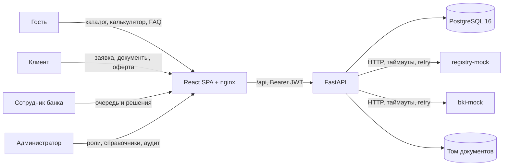
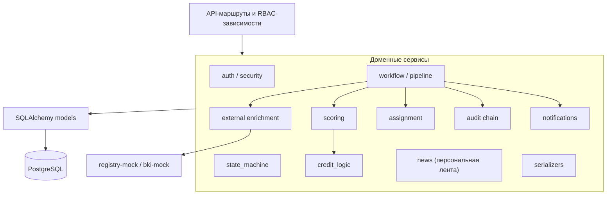

# Архитектура CreditPath

## Контекст



Все внешние источники данных — локальные контейнеры на синтетических данных. Исходящих вызовов в интернет нет. nginx отдаёт SPA, проксирует API и документацию, применяет security-заголовки.

## Компоненты

| Компонент | Ответственность |
|---|---|
| `frontend` | React 18 + TypeScript + Vite, React Router, TanStack Query. Дизайн-система на CSS. Сборка в статические файлы, runtime — nginx. |
| `backend` | FastAPI, SQLAlchemy 2, Alembic, Pydantic v2. Аутентификация, RBAC, конечный автомат, автоматические проверки, скоринг, кредитная логика, назначение, уведомления, персональная лента новостей, аудит. |
| `db` | PostgreSQL 16, том `postgres_data`, healthcheck `pg_isready`. |
| `registry-mock` | Синтетический реестр компаний, статический JSON внутри образа. |
| `bki-mock` | Синтетическая кредитная история, статический JSON внутри образа. |
| `uploads_data` | Приватный именованный том для файлов заявок. |

## Слои backend



- **Routes** отвечают за HTTP, валидацию схемы, объектную авторизацию и коды ответов.
- **state_machine** — единственная точка смены технического статуса; проверяет матрицу переходов, пишет событие заявки и запись аудита.
- **workflow** выполняет автоматический конвейер в фоновой задаче процесса и сохраняет каждый этап отдельным коммитом.
- **scoring** не принимает решений: только балл 0–100 и факторы с причинами.
- **credit_logic** отдельно применяет стоп-факторы, продуктовые требования и пороги, формируя предварительное решение.
- **assignment** реализует round-robin по минимальной нагрузке, правило «свежего взгляда» и очередь администратора.
- **audit chain** добавляет записи только через одну функцию, сериализует вставку advisory lock и считает SHA-256-цепочку.

## Жизненный цикл запроса

```mermaid
sequenceDiagram
    autonumber
    participant C as Клиент
    participant N as nginx / SPA
    participant A as FastAPI
    participant W as Background pipeline
    participant R as registry-mock
    participant B as bki-mock
    participant E as Сотрудник
    C->>N: Отправка заявки + Idempotency-Key
    N->>A: POST /api/client/applications/{id}/submit
    A->>A: Транзакция DRAFT → SUBMITTED, аудит, idempotency
    A-->>C: 202 Accepted
    A->>W: run_pipeline(application_id)
    W->>A: VALIDATION → ENRICHMENT, коммит
    W->>R: GET /registry/{inn}
    W->>B: GET /bki/{inn}
    W->>A: Снимок данных, ENRICHMENT → SCORING, коммит
    W->>A: Балл и факторы, SCORING → DECISION_DRAFT
    W->>A: Кредитная логика, DECISION_DRAFT → IN_REVIEW
    W->>A: Назначение сотрудника, уведомления, коммит
    E->>A: POST /api/employee/applications/{id}/decision
    A->>A: Проверка назначения, автора, цепочки; финальный статус, аудит
    A-->>C: Уведомление в центре, новый статус
```

## Модель безопасности

- JWT Bearer с коротким сроком (60 минут по умолчанию), подпись HS256, секрет только из окружения.
- Пароли — Argon2id, демонстрационный пароль используется только для seed-учёток.
- RBAC и объектная авторизация выполняются на сервере; UI скрывает недоступные действия, но не является границей безопасности.
- Клиентские эндпоинты доступны любой аутентифицированной роли, но всегда проверяют владельца объекта. Служебная очередь исключает заявки, поданные с учётной записи сотрудника, а кредитные решения доступны только роли «Сотрудник банка».
- Rate limit входа по IP и логину, ответ 429 с `Retry-After`.
- Ограничение размера загрузки, проверка MIME, расширения и сигнатуры файла; скачивание только через авторизованный endpoint.
- CORS из конфигурации; security-заголовки в nginx и FastAPI; CSP для SPA и отдельная CSP для Swagger UI.
- Аудит append-only: триггер PostgreSQL отклоняет UPDATE/DELETE. Цепочка хешей позволяет обнаружить изменение.
- Одобрение ниже порога или вопреки стоп-фактору дополнительно фиксируется как `application.risk_override` с баллом, порогом, стоп-факторами и условиями сделки.
- Логи структурированные JSON с request id; тела запросов, токены и пароли не логируются.

## Надёжность и масштабирование

- Healthcheck БД и всех контейнеров, зависимости по `service_healthy`, `restart: unless-stopped`.
- Alembic-миграции при старте backend; seed идемпотентен.
- Каждый этап конвейера фиксируется отдельно. При сбое заявка не теряется и переводится в понятное состояние NEED_INFO.
- Внешние HTTP-вызовы имеют таймауты и повторные попытки; сырые ответы сохраняются как снимки.
- Для production: вынести фоновый конвейер в очередь, увеличить число процессов, перенести rate limit в Redis, включить httpOnly refresh cookies, централизованный сбор логов и резервное копирование. См. ROADMAP.

## Развёртывание

```text
browser :8080
   │
nginx (frontend)
   ├── /            → static React
   ├── /api/        → backend:8000
   ├── /docs        → backend:8000/docs
   └── /static/swagger/ → self-hosted Swagger UI
backend:8000
   ├── db:5432
   ├── registry-mock:8000
   └── bki-mock:8000
```
