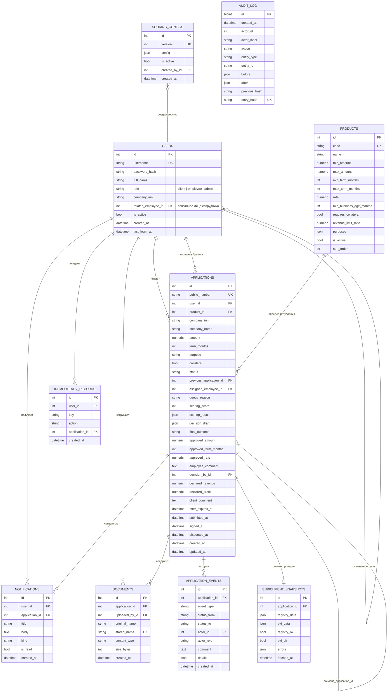

# Модель данных

`AUDIT_LOG` намеренно не имеет внешних ключей: записи должны переживать изменения и деактивацию пользователей.

## Ограничения и индексы

- `users.username` — уникальный.
- `applications.public_number` — уникальный; составные индексы `(status, created_at)` и `(company_inn, status)`, отдельные индексы по пользователю, продукту, сотруднику и `final_outcome`.
- `documents.stored_name` — уникальное имя в томе.
- `enrichment_snapshots.application_id` — один актуальный снимок на заявку; история изменений заявки остаётся в событиях.
- `idempotency_records` — уникальная тройка `(user_id, key, action)`.
- `scoring_configs.version` — уникальная версия, одна активная версия.
- `audit_log.entry_hash` — уникальный; переходы статусов фиксируются в одной транзакции с записью аудита.
- Триггер `audit_log_append_only` запрещает `UPDATE` и `DELETE` на `audit_log` в PostgreSQL.

## Снимки внешних данных

`registry_data` и `bki_data` — полные ответы мок-сервисов на момент проверки. Это позволяет сотруднику видеть именно те данные, на основании которых сформировано предварительное решение, даже если источник позже изменится. Заявленные клиентом финансовые показатели хранятся отдельно (`declared_revenue`, `declared_profit`) и явно помечаются `financial_source = client_declared`.
