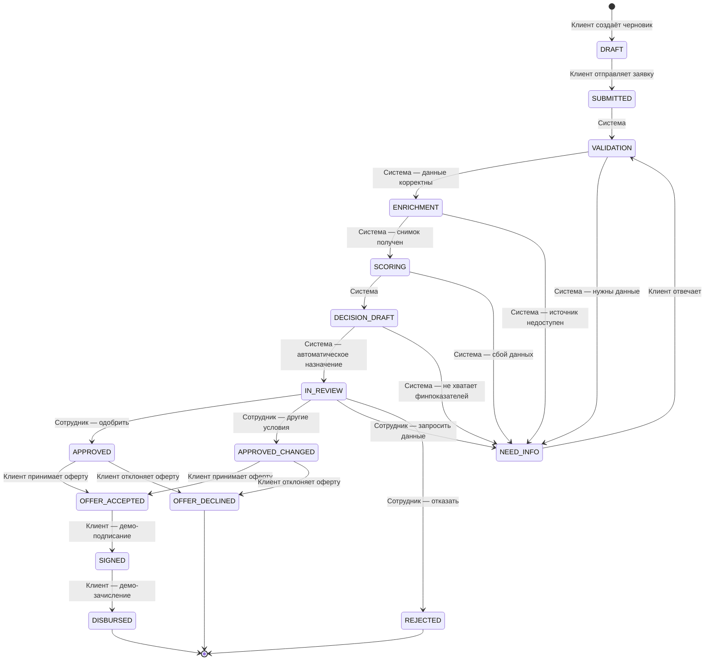

# Конечный автомат заявки

Переходы валидируются на сервере (`app/services/state_machine.py`). Любой недопустимый переход возвращает 409 и не изменяет заявку. Каждый успешный переход записывается в `application_events` и в append-only `audit_log`.

## Роли у переходов

| Переход | Кто выполняет | Дополнительно |
|---|---|---|
| DRAFT → SUBMITTED | Клиент | Только владелец; Idempotency-Key; валидация продукта и ИНН |
| SUBMITTED → VALIDATION → ENRICHMENT → SCORING → DECISION_DRAFT | Система | Фоновый конвейер, каждый этап сохраняется |
| DECISION_DRAFT → IN_REVIEW | Система | Назначение по нагрузке и правилу «свежего взгляда» |
| DECISION_DRAFT → NEED_INFO | Система | Нет финансовых показателей или источник временно недоступен |
| IN_REVIEW → APPROVED / APPROVED_CHANGED / REJECTED / NEED_INFO | Сотрудник банка | Только назначенный сотрудник, не автор заявки, не участник цепочки; отказ и запрос данных требуют комментария |
| NEED_INFO → VALIDATION | Клиент | Владелец заявки; ответ и, при необходимости, документы |
| APPROVED / APPROVED_CHANGED → OFFER_ACCEPTED / OFFER_DECLINED | Клиент | Владелец, срок оферты не истёк |
| OFFER_ACCEPTED → SIGNED | Клиент | Демонстрационное подписание |
| SIGNED → DISBURSED | Клиент | Демонстрационное зачисление |

Администратор **не имеет** переходов, связанных с кредитным решением.

## Клиентские статусы

| Технические статусы | Клиентский статус |
|---|---|
| DRAFT | Черновик |
| SUBMITTED | Заявка отправлена |
| VALIDATION, ENRICHMENT, SCORING, DECISION_DRAFT | Заявка рассматривается |
| IN_REVIEW | На рассмотрении у сотрудника |
| NEED_INFO | Требуется уточнение |
| APPROVED, APPROVED_CHANGED, REJECTED, OFFER_ACCEPTED, OFFER_DECLINED, SIGNED, DISBURSED | Рассмотрено |

## Четыре исхода

1. **Одобрено** — порог и проверки пройдены, сотрудник подтверждает запрошенные условия.
2. **Одобрено на других условиях** — балл 40–69; сумма и/или срок корректируются по продуктовым правилам.
3. **Нужны дополнительные данные** — не хватает финансовых показателей или источник проверки временно недоступен; клиент отвечает, заявка возвращается в VALIDATION.
4. **Отказ** — стоп-фактор (недействующая компания, активная просрочка), низкий балл или отказ сотрудника с обязательной причиной.

Правило «свежего взгляда»: повторная заявка после отказа связывается с предыдущей через `previous_application_id`; сотрудники, назначенные на любую заявку цепочки или принявшие по ней решение, исключаются из назначения. Сотрудник также не может рассматривать заявку, поданную с его собственной учётной записи: она исключается из его служебной очереди, статистики и карточки (404), хотя остаётся доступной ему как клиенту в разделе «Мои заявки».

Клиентские переходы `DRAFT → SUBMITTED` и действия с офертой доступны любой аутентифицированной роли в её собственном клиентском кабинете. Служебные переходы, требующие роли сотрудника, администратору недоступны.
